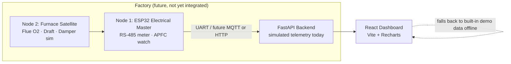

# EcoSidecar-360

**Industrial energy monitoring and optimization platform for MSMEs.**

> ⚠️ **DEMO / TRL 3 CONCEPT** — Everything in this repository runs on **simulated data by default**. Nothing here is field-measured, no customer deployment exists, and no savings figure is a measured result. Figures labelled "modelled" come from the Plant R1 reference model in the docs.

## Problem
Indian manufacturing MSMEs often run with no visibility into demand peaks, poor power factor, idle compressor baseload, or excess-air furnace losses — and cannot afford to replace machinery. EcoSidecar-360 is a proposed **non-invasive retrofit**: clip-on / panel metering + a furnace-side sensing node + a dashboard, advisory-first, so the factory keeps running exactly as today if the box is removed.

## Key features
- Dark industrial dashboard: demand vs ToU tariff, MCSA spectrum, load donut, solar/grid, assets, events
- 15-minute demand window with projection + compressor load-shed logic (firmware, simulated)
- Flue O₂ / draft simulation with bounded damper trim (±15° authority, simulated)
- Transparent, unit-tested calculations (tariff, projection, savings, grid import, motor-health bands)
- Lightweight FastAPI backend serving simulated telemetry + a documented future ESP32 ingestion endpoint
- DEMO MODE banner everywhere simulated data is shown

## Architecture


## Repository structure
```
frontend/   React + Vite dashboard
firmware/   ESP32 (PlatformIO) — simulation-only reference
backend/    FastAPI simulated-telemetry API
docs/       architecture, hardware, telemetry, setup, safety
tests/      frontend (Vitest) + backend (pytest)
```

## Tech stack
React 18 · Vite 5 · Recharts · FastAPI · Python 3.12 · ESP32 / Arduino (PlatformIO) · GitHub Actions CI

## Run it locally (exact commands)
**Dashboard only (works offline, demo data built in):**
```bash
cd frontend
npm install
npm run dev        # open http://localhost:5173
```
**Backend (optional — dashboard works without it):**
```bash
cd backend
python3 -m venv .venv && source .venv/bin/activate
pip install -r requirements.txt
uvicorn app.main:app --reload --port 8000   # http://localhost:8000/docs
```
**Production build check:**
```bash
cd frontend && npm run build
```

## Run tests
```bash
cd frontend && npx vitest run
# backend (from repo root, inside the venv from the install step):
python3 -m pytest tests/backend -v
```

## Screenshots
Add yours after running locally: `docs/screenshots/overview.png` (capture the Overview page at https://eco-sidecar-360.vercel.app/). No screenshot is bundled because bundling a staged image as a "result" would misrepresent a simulated demo.

## Hardware & firmware
See `docs/hardware-overview.md` and `firmware/README.md`. Default firmware mode is **simulation-only**; live actuation is disabled by compile flags and requires a safety review.

## Demo mode
`VITE_DEMO_MODE=true` (default). The amber DEMO banner is part of the UI and must stay until real sensors are connected and validated.

## Known limitations
- No live ESP32 → backend telemetry yet (`POST /api/telemetry` is an honest stub: accepts, does not persist)
- RS-485 meter, modem, and SD drivers are pin definitions only
- MCSA "health" is a banding function on simulated spectra — not a diagnosis
- Savings are modelled against an assumed 11,140 kWh/month baseline — not measured
- No industrial safety-standard compliance is claimed

## Roadmap
1. Bench-validate meter reading over RS-485 (Level 0, read-only)  2. Persist telemetry (SQLite)  3. Time-weighted demand projection + pressure hysteresis  4. One real flue-gas reading to anchor the O₂ model  5. Field pilot only after third-party safety review

## Contributing
Fork, branch, keep the DEMO labelling intact, run the tests, open a PR describing what is simulated vs real.

## License
MIT — see `LICENSE`.
